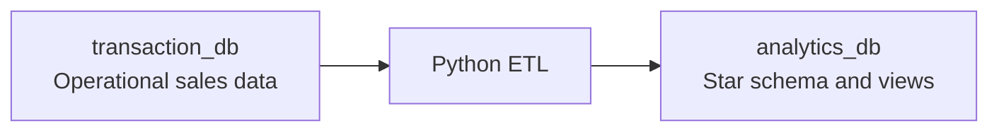

# Geek Store Data Platform

This project provisions two independent SQL Server Developer Edition instances and loads a small geek-store data warehouse from the transactional database.

## Architecture



| Component | Purpose | Host connection |
| --- | --- | --- |
| `transaction-db` | Products, clients, orders, order items, and payments. | `localhost,14331` |
| `analytics-db` | Dimensions, order facts, item facts, and reporting views. | `localhost,14332` |

Both instances use the `everton` login and the `@da123*` password. They are intended for local development only. Each database is persisted in a Docker named volume.

## Start The Databases

From this folder, run:

```powershell
docker compose up --build -d
docker compose ps
```

The containers become healthy after SQL Server and the initialization scripts finish. To reset all databases and rerun every initialization script from scratch:

```powershell
docker compose down -v
docker compose up --build -d
```

To connect from an IDE such as Azure Data Studio, SSMS, or DBeaver, use the following settings:

| Setting | Transactional database | Analytics database |
| --- | --- | --- |
| Server | `localhost,14331` | `localhost,14332` |
| Authentication | SQL Login | SQL Login |
| User | `everton` | `everton` |
| Password | `@da123*` | `@da123*` |
| Database | `transaction_db` | `analytics_db` |
| Encryption | Trust server certificate for local development. | Trust server certificate for local development. |

Connection strings:

```text
Server=localhost,14331;Database=transaction_db;User Id=everton;Password=@da123*;Encrypt=False;TrustServerCertificate=True;
Server=localhost,14332;Database=analytics_db;User Id=everton;Password=@da123*;Encrypt=False;TrustServerCertificate=True;
```

## Dashboard

The `dashboard` service provides a responsive visual report using the analytics views. It shows sales KPIs, weekday sales flow, customer-age revenue, payment performance, and the eight highest-revenue products.

After the ETL completes, start or update all services and open `http://localhost:8080` in a browser:

```powershell
docker compose up --build -d
```

## Transactional Model

The scripts in [db-transaction/scripts](db-transaction/scripts) create the operational model.

| Table | Purpose |
| --- | --- |
| `ProductType` | Product categories, including Action Figure, Manga, Cosplay, Funk Pop, Board Game, Collectible, Gaming, and Apparel. |
| `Product` | Geek catalog with price, stock, status, and product type. |
| `Client` | Customers with email and birth date. |
| `Order` | A customer sale. The table name is escaped as `[Order]` because `ORDER` is a SQL keyword. |
| `OrderItem` | Sale lines with historical unit price and computed line total. |
| `PaymentType` | Cash, Debit Card, Credit Card, and Pix. |
| `Payment` | Exactly one payment for each order. |

The deterministic seed scripts provide:

- 200 uniquely named geek products.
- 50 recognizable geek-world customers.
- 225 paid orders across 180 days.
- From 2 to 50 distinct product lines per order, with quantities from 1 to 5.
- One payment for every order.

The scripts use `MERGE`, unique keys, and checks so they can be re-run safely on an existing development volume.

## Analytics Model

The scripts in [db-analytics/scripts](db-analytics/scripts) create a star schema.

| Object | Grain or purpose |
| --- | --- |
| `DimDate` | One row per calendar date, with weekday, month, quarter, and weekend attributes. |
| `DimClient` | One row per source client. |
| `DimProduct` | One row per source product, including type and price band. |
| `DimPaymentType` | One row per source payment method. |
| `FactOrder` | One row per order. This is the correct fact for average ticket and customer behavior. |
| `FactOrderItem` | One row per order item. This supports product, category, and quantity analysis. |

`FactOrder` stores the customer age and age group at the time of purchase, so historical age analysis remains correct. It also keeps the payment amount, item count, quantity, and order total.

The following reporting views are created:

| View | Analysis |
| --- | --- |
| `vw_ClientPurchasesByAge` | Orders, revenue, and average ticket by customer age and age group. |
| `vw_WeekdaySalesFlow` | Sales flow and ticket by weekday. |
| `vw_SalesKpis` | Revenue, order count, unique customers, units sold, and average ticket. |
| `vw_ProductPerformance` | Revenue and units sold by product and product type. |
| `vw_PaymentMethodPerformance` | Order count, payment volume, and ticket by payment method. |

Example queries:

```sql
USE analytics_db;
SELECT * FROM dbo.vw_SalesKpis;
SELECT * FROM dbo.vw_WeekdaySalesFlow ORDER BY DayOfWeekNumber;
SELECT * FROM dbo.vw_ClientPurchasesByAge ORDER BY CustomerAgeGroup, CustomerAgeAtOrder;
SELECT TOP (20) * FROM dbo.vw_ProductPerformance ORDER BY Revenue DESC;
```

## Run The ETL

The ETL is a small Python package under [etl](etl). It separates source queries, transformations, SQL Server loading, configuration, and orchestration.

To generate up to 200 additional random paid orders and matching payments before an ETL run, use [transaction-generator](transaction-generator). It uses the existing transactional reference data and product stock.

### Generate New Transactions

After the transactional database is healthy, generate new workload data from this folder with:

```powershell
py transaction-generator/generate_transactions.py --count 50
```

The `--count` value must be between `1` and `200`. To generate a reproducible dataset, pass a random seed:

```powershell
py transaction-generator/generate_transactions.py --count 200 --seed 42
```

Each generated transaction creates a paid order, its order items, and a payment for the exact order total. The generator only uses active products with available stock and updates the stock quantity.

1. Install Python 3.11 or later and Microsoft ODBC Driver 18 for SQL Server.
2. Copy `.env.example` to `.env` if the default local connection details need to change.
3. Install the dependencies and run the package from this folder:

```powershell
py -m pip install -r etl/requirements.txt
py -m etl
```

The ETL logs the extraction counts, each load, and final fact-count validation. Its load behavior is idempotent:

- All dimensions use a staging table plus `MERGE` on the source business key.
- `FactOrder` merges on `OrderBusinessKey`.
- `FactOrderItem` merges on `OrderItemBusinessKey`.
- The final validation verifies that warehouse fact counts match source order and item counts.

### Reset The Analytics Warehouse

Before a new full ETL load, run [db-analytics/truncate_analytics.sql](db-analytics/truncate_analytics.sql) against `analytics_db`. The script removes the foreign keys required by SQL Server's `TRUNCATE` restriction, truncates all fact and dimension tables, and recreates the constraints in the same transaction. Reporting views remain available and identity keys restart from their initial values.

For a local Docker deployment, the default environment values work without changes. When running the ETL from another container in the `geek-data-network`, use `transaction-db,1433` and `analytics-db,1433` as the database hosts instead of the localhost ports.

## Folder Layout

```text
.
|-- db-transaction/
|   |-- Dockerfile
|   |-- entrypoint.sh
|   `-- scripts/
|-- db-analytics/
|   |-- Dockerfile
|   |-- entrypoint.sh
|   |-- truncate_analytics.sql
|   `-- scripts/
|-- dashboard/
|   |-- Dockerfile
|   |-- server.js
|   `-- public/
|-- etl/
|   |-- config.py
|   |-- extract.py
|   |-- transform.py
|   |-- load.py
|   `-- pipeline.py
|-- poke-website/
|   |-- index.html
|   |-- app.js
|   |-- styles.css
|   `-- README.md
|-- transaction-generator/
|   |-- generate_transactions.py
|   `-- README.md
|-- docker-compose.yml
`-- .env.example
```