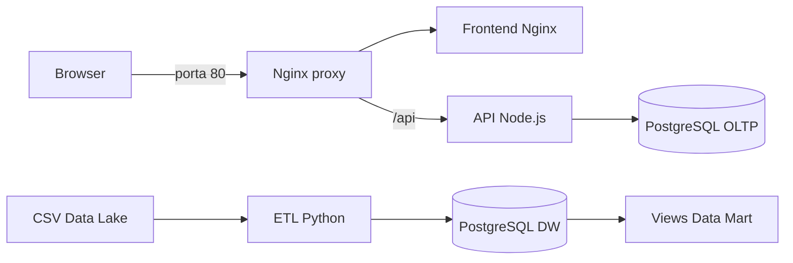

# MovieFlix Platform

Projeto final de Arquitetura de Serviços e Dados. A solução reúne um CRUD de produtos, proxy reverso, bancos OLTP e analítico, Data Lake local, ETL, Data Marts e CI/CD.

O enunciado original permanece disponível em `enunciado-trabalho-final.md`.

## Arquitetura



Serviços principais:

| Serviço | Responsabilidade | Exposição |
|---|---|---|
| `proxy` | Entrada única e roteamento Nginx | `80` |
| `frontend` | Interface HTML/CSS/JS | Somente rede interna |
| `backend` | API REST Express | Somente rede interna |
| `db-oltp` | Cadastro transacional de produtos | Somente rede interna |
| `db-dw` | Data Warehouse MovieFlix | `5433` |
| `etl` | Carga dos CSVs no DW | Execução sob demanda |

## Pré-requisitos

- Docker Desktop com Docker Compose v2.
- Git.
- PowerShell para executar o smoke test no Windows.

## Execução rápida

Crie o arquivo de ambiente e inicie a aplicação:

```powershell
Copy-Item .env.example .env
docker compose up --detach --build --wait
```

Acesse `http://localhost`. Caso a porta 80 esteja ocupada, altere `APP_PORT` no `.env`, por exemplo para `8080`, e acesse `http://localhost:8080`.

Verifique os serviços e logs:

```powershell
docker compose ps
docker compose logs --follow
```

## API de produtos

| Método | Rota | Ação |
|---|---|---|
| `GET` | `/api/products` | Lista produtos |
| `GET` | `/api/products/{id}` | Busca um produto |
| `POST` | `/api/products` | Cria um produto |
| `PUT` | `/api/products/{id}` | Atualiza um produto |
| `DELETE` | `/api/products/{id}` | Exclui um produto |

Exemplo:

```powershell
Invoke-RestMethod http://localhost/api/products `
  -Method Post `
  -ContentType "application/json" `
  -Body '{"name":"Webcam"}'
```

O nome é obrigatório e aceita no máximo 50 caracteres. As queries usam parâmetros posicionais para evitar injeção SQL.

## Testes

Teste unitário da API:

```powershell
Set-Location backend
npm ci
npm test
Set-Location ..
```

Smoke test pelo proxy, incluindo criação, leitura, atualização e exclusão:

```powershell
./scripts/smoke-test.ps1
```

Para outra porta:

```powershell
./scripts/smoke-test.ps1 -BaseUrl http://localhost:8080
```

## Ecossistema de dados

O Data Lake está em `data-ecosystem/datalake` e contém:

- `movies.csv`: catálogo de filmes.
- `users.csv`: usuários, idade e país.
- `ratings.csv`: avaliações de 1 a 5.

Execute a carga idempotente:

```powershell
docker compose --profile etl run --rm etl
```

O ETL valida os cabeçalhos, limpa as tabelas na ordem correta e recarrega dimensões e fatos em uma transação.

### Data Marts

- `vw_top_10_movies_by_genre`: ranking de filmes por gênero.
- `vw_average_rating_by_age_group`: nota média por faixa etária.
- `vw_ratings_by_country`: volume e média por país.

Consulte uma view:

```powershell
docker compose exec db-dw psql -U dw_user -d movieflix_dw `
  -c "SELECT * FROM vw_ratings_by_country ORDER BY rating_count DESC;"
```

Execute as três perguntas de negócio:

```powershell
Get-Content ./data-ecosystem/sql/03_analytics.sql -Raw | `
  docker compose exec -T db-dw psql -U dw_user -d movieflix_dw
```

## CI/CD

A pipeline `.github/workflows/main.yml` executa:

1. Testes unitários da API.
2. Build das quatro imagens próprias.
3. Inicialização e smoke test da aplicação.
4. Carga e validação do Data Warehouse.
5. Push no Docker Hub em commits na branch `main`.

Configure estes secrets no GitHub:

- `DOCKERHUB_USERNAME`: usuário do Docker Hub.
- `DOCKERHUB_TOKEN`: access token do Docker Hub.

Imagens publicadas:

- `movieflix-proxy`
- `movieflix-frontend`
- `movieflix-backend`
- `movieflix-etl`

Cada imagem recebe a tag `latest` e uma versão SemVer compartilhada. A primeira publicação usa `1.0.0`; cada push posterior na branch `main` incrementa a versão minor: `1.1.0`, `1.2.0`, `1.3.0` e assim por diante. A pipeline consulta as tags do `movieflix-proxy` no Docker Hub para determinar a próxima versão.

## Bônus DNS

1. Crie um domínio no DuckDNS ou No-IP.
2. Aponte o registro para o IP público da máquina/servidor.
3. Libere e encaminhe a porta 80 no firewall/roteador.
4. Mantenha o container `proxy` como único serviço público.

Para uma exposição real na internet, adicione HTTPS, armazene segredos fora do Compose e restrinja a porta do DW.

## Encerrar

Preserve os bancos:

```powershell
docker compose down
```

Remova também os dados persistidos:

```powershell
docker compose down --volumes
```