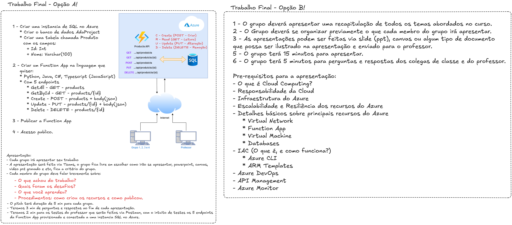

# **Trabalho Final | Serviços para desenvolvedor na Azure** 🚀
--- <cite>*Professor:* Everton José Benedicto</cite>

## **Resumo** 📝
Estou dando a vocês a opção de duas entregas, Opção A e Opção B. A opção A é para aqueles grupos que conseguiram passar pelos desafios dos bloqueios de rede local, e a opção B é para aqueles que realmente não conseguiram. Segue abaixo o detalhe dos dois tipos de trabalho:

## **Opção** 🅰️

### **Tarefas**
1.  **Criar uma instância do SQL no Azure** 🗄️
    * Criar um banco de dados **Azure SQL Database**.
    * Criar uma tabela chamada **Produto** com os campos:
        * **Id**: `Int`
        * **Nome**: `Varchar(100)`
2.  **Criar uma Function App em qualquer linguagem** ⚡
    * Linguagens: Python, Java, C#, Typescript (JavaScript).
    * Deve ter 5 endpoints:
        * `GetAll`: `GET` - produtos 📋
        * `GetById`: `GET` - produtos/{id} 🔍
        * `Create`: `POST` - produtos/{id} com `body(json)` ➕
        * `Update`: `PUT` - produtos/{id} com `body(json)` ✏️
        * `Delete`: `DELETE` - produtos/{id} 🗑️
3.  **Publicar a Function App** ☁️
4.  **Acesso público** 🌐

### **Apresentação** 🎤
* Cada grupo irá apresentar seu trabalho.
* A apresentação será feita via Teams. O grupo pode escolher o formato (PowerPoint, Canvas, vídeo pré-gravado, etc.).
* Cada membro do grupo deve falar brevemente sobre:
    * O que achou do trabalho? 🤔
    * Quais foram os desafios? 🧩
    * O que você aprendeu? 📚
    * Procedimentos: como criou os recursos e como publicou. 🛠️
* O pitch terá duração de 5 minutos para cada grupo. ⏱️
* Serão 3 minutos para perguntas e respostas ao final de cada apresentação. ❓
* Serão 2 minutos para os testes do professor, que serão feitos via Postman, para testar os 5 endpoints da Function App provisionada e conectada à instância SQL no Azure. 🧪

---

## **Opção** 🅱️

### **Requisitos da Apresentação**
1.  O grupo deve apresentar um resumo de todos os tópicos abordados no curso. 📚
2.  O grupo deve se organizar previamente para que cada membro apresente uma parte. 👥
3.  As apresentações podem ser feitas via slides (PPT), canvas ou qualquer outro tipo de documento que possa ser incluído na apresentação ou enviado ao professor. 🖼️
4.  O grupo tem *15 minutos* para apresentar. ⏲️
5.  O grupo tem *5 minutos* para perguntas e respostas dos colegas e do professor. ❓

### **Tópicos para a apresentação:**
* O que é **Cloud Computing**? ☁️
* Responsabilidade da nuvem (**Cloud Responsibility**) 🛡️
* Infraestrutura do Azure 🏗️
* Escalabilidade e resiliência dos recursos do Azure 📈
* Detalhes básicos sobre os principais recursos do Azure:
    * **Virtual Network** 🌐
    * **Function App** ⚡
    * **Virtual Machine** 🖥️
    * **Databases** 🗄️
    * **IaC** 📝
        * **Azure CLI (O que é, e como funciona?)** 💻
        * **ARM Templates** 🧩
    * **Azure DevOps** 🔄
    * **API Management** 🔗
    * **Azure Monitor** 📊

